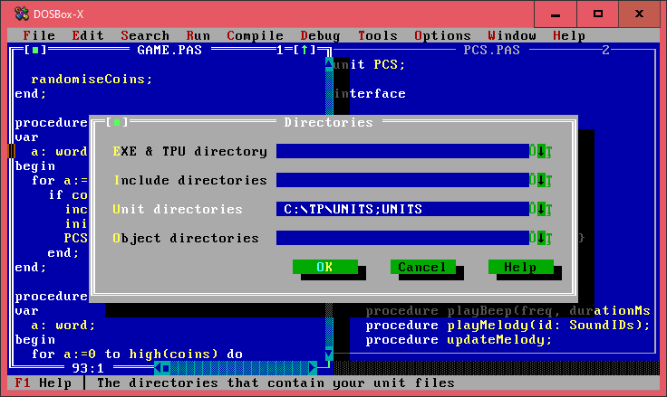
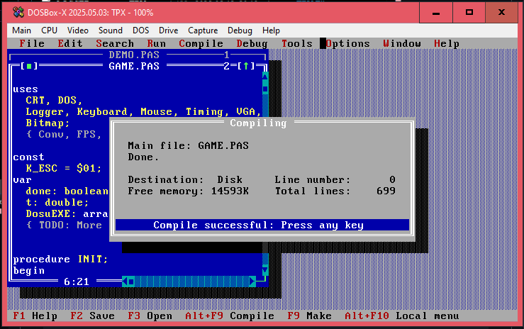
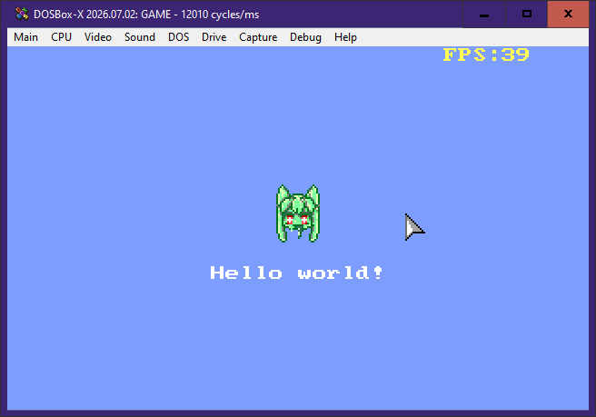

# Building

## Requirements

- **Turbo Pascal 7.0** is required to build the unit files and the executable
- **js-dos** is required for web exports (`v7` is preferred)

## Building a demo

Assuming that you've made a shallow copy of the Posit-92 repo

1. Start your DOSBox of choice, make sure that the CPU cycles setting is set to at least `10000` or `max`,
2. Start the **Turbo Pascal 7 IDE** (`TPX.EXE`),
3. Change directory to a demo project (**File menu > Change Dir**),
4. Open `GAME.PAS` (this is automatically set as the primary file),
5. Add the `UNITS` directory (**Options > Directories...**) as shown below:
   

   This is only done once. After pressing OK, you should save your IDE config by:
   
   **Options menu > Save**, or shorter: **Alt+O, then S**

6. And lastly, press `F9` to **Make** the project, then you can run it by: **Run menu > Run** or by pressing `Ctrl+F9`

When it's done, all the compiled unit files (`.TPU` files) and the EXE should be in the same directory as the primary file.

The IDE will show something like this when it's done:

and this is how the runtime looks like:

