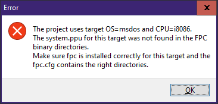

# New DOS project guide

This document is more of a guideline rather than rigid rules

## Copying the boilerplate

1. Copy the latest boilerplate: `DEMOS\SIMPLE`

   This directory will be the root of your new project
2. Copy the `UNITS` folder, rename it as `ENGINE` in your project
3. Create a new `UNITS` folder. This is where your custom units will live
4. Copy Turbo Pascal 7.0 into your new project, at the root, name the folder as `TP` or `TP7`

The project structure should look more or less like this:

```text
- IMG\
- ENGINE\
- UNITS\
- TP\
- GAME.PAS
- PROJECT.LPI (optional)
```

If you see `PROJECT.LPI`, you can edit the game using Lazarus IDE as a fancy autocomplete, while the compiler itself still uses Turbo Pascal

You can use the directory where `GAME.PAS` and `PROJECT.LPI` belong as your working directory from now on

### Cleaning leftover files

Sometimes there are existing TPU files, GAME.EXE, and some other leftovers, you can delete those

Usually they're these:

- `ENGINE\*.TPU`, or any `.TPU` files
- `GAME.EXE`
- `LOG.TXT`
- `project.lps` (if you use Lazarus)

## Setting up unit paths

After copying the boilerplate manually, the next step is to edit the unit search paths

1. Open Turbo Pascal 7
2. Click the Options menu (or `Alt+O`)
3. Then click (D)irectories

Then, inside the Directories popup, press `Alt+U` to focus on the **Unit directories** field

Now change it to the new project structure, something like this:

```
C:\TP\UNITS;ENGINE;UNITS
```

The order is as follows:
- Turbo Pascal 7 units
- Posit-92 units
- User-defined units

Think of it more like "The units get more specific use cases the further it's on the right"

### Lazarus integration

If you use Lazarus, change the unit search paths to reference your own `fpc-msdos-i8086` installation, then followed by `ENGINE` and `UNITS`

How to do it:
- **Project menu --> Project options**, or shorter: `Shift+Ctrl+F11`
- On the left side panel: Under **Compiler options**, click **paths**
- Click the triple dots next to the "Other unit files (-Fu)"

Change the search paths to be more or less like this:

- `E:\fpc-msdos-i8086\fpcsrc\rtl\units\msdos\`
- `E:\fpc-msdos-i8086\fpc\units\i8086-msdos\rtl-console\`
- `ENGINE`
- `UNITS`

Again, the path `E:\fpc-msdos-i8086` depends on your compiler setup

After that, press OK, then OK again

If there's an error like this:



You can simply ignore it since we're compiling with Turbo Pascal anyway, but if you include the unit `CRT` or `DOS`, you can Ctrl+click any of those.  Lazarus still points to the right unit file

## `Double` type usage

Posit-92 uses `double` all the time because it's faster, considering the use of FPU (floating point unit)

This must be enabled in the Turbo Pascal IDE:
- in the **Options --> Compiler**, then
- under **Numeric processing**, enable 8087/80287
- Click OK or simply press ENTER

After pressing OK, don't forget to save your config by clicking the **Options** menu, then click **Save**, or shorter: `Alt+O, then S`
